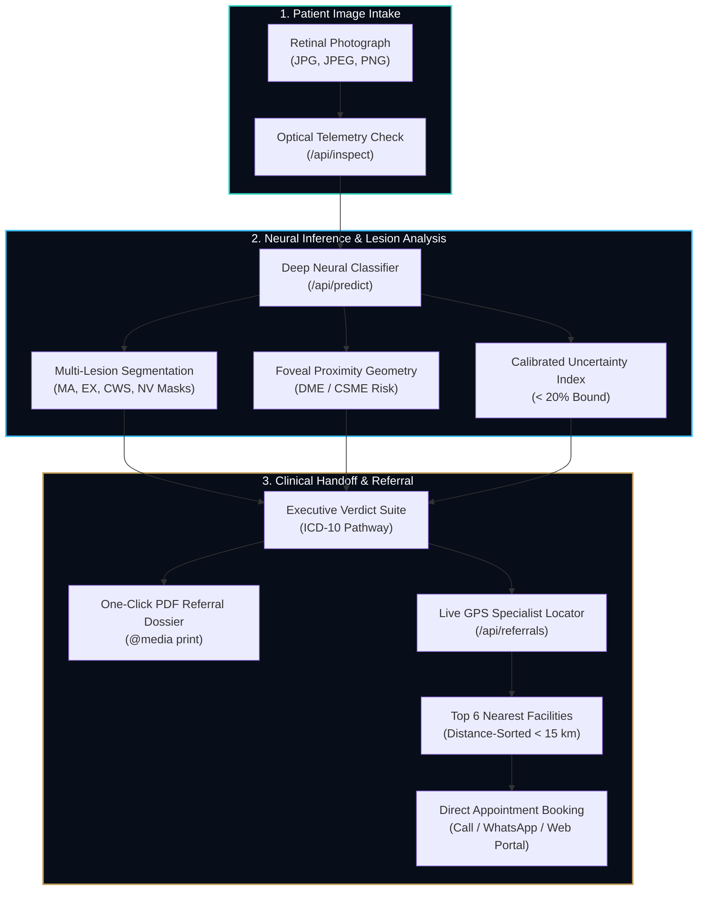

<div align="center">

# 👁️ Insight Retinal Diagnostic Suite

### *Autonomous Point-of-Care Retinopathy Screening, Lesion Segmentation & Tele-Ophthalmology Referral Platform*

[](https://python.org)
[](https://pytorch.org)
[](https://flask.palletsprojects.com)
[](https://www.openstreetmap.org)
[](LICENSE)
[]()

<br/>

> **Insight** is an AI-powered diagnostic and tele-ophthalmology platform that analyzes fundus photography to detect Diabetic Retinopathy (DR), isolate micro-vascular lesions, assess Macular Edema (DME) risk, generate ICD-10 coded clinical referral dossiers, and connect patients with the closest verified retina specialists.

</div>

---

## 📑 Table of Contents

- [Key Capabilities](#-key-capabilities)
- [System Architecture](#-system-architecture)
- [Clinical Algorithms & Diagnostic Engine](#-clinical-algorithms--diagnostic-engine)
  - [1. Optical Quality Telemetry](#1-optical-quality-telemetry)
  - [2. Multi-Class Retinopathy Staging](#2-multi-class-retinopathy-staging)
  - [3. Multi-Lesion Segmentation Overlay](#3-multi-lesion-segmentation-overlay)
  - [4. Macular Edema (DME) Risk Scoring](#4-macular-edema-dme-risk-scoring)
  - [5. Calibrated Model Uncertainty](#5-calibrated-model-uncertainty)
  - [6. Geolocation & Proximity Specialist Routing](#6-geolocation--proximity-specialist-routing)
- [User Interface & Console Design](#-user-interface--console-design)
- [Tech Stack](#-tech-stack)
- [Quick Start & Installation](#-quick-start--installation)
- [API Reference](#-api-reference)
- [Clinical Safety & Research Disclaimer](#-clinical-safety--research-disclaimer)

---

## 🌟 Key Capabilities

| Capability | Description |
|---|---|
| **🔬 Optical Quality Pre-Check** | Evaluates resolution, mean luminance, contrast dispersion, and color balance to flag sub-optimal fundus imagery prior to neural inference. |
| **🧠 Deep Neural DR Grading** | Multi-class staging (No DR, Mild NPDR, Moderate NPDR, Severe NPDR, PDR) with calibrated probability confidence distributions. |
| **🎨 Multi-Lesion Canvas Overlay** | 4-channel pixel segmentation isolating **Microaneurysms**, **Hard Exudates**, **Cotton Wool Spots**, and **Neovascularization** with real-time cluster counts. |
| **👁️ DME / CSME Risk Engine** | Geometric foveal proximity algorithm detecting central macular lipid exudation and focal vascular leakage within 1-disc diameter. |
| **📄 1-Click PDF Medical Dossier** | Printable black-and-white clinical dossier styled via `@media print`, complete with reference codes, ICD-10 diagnostic coding (`E11.311`–`E11.359`), and doctor signature blocks. |
| **📍 Proximity-Ranked Referrals** | Live GPS & Area search via OpenStreetMap Nominatim delivering the **Top 6 nearest verified eye hospitals** strictly ordered by driving proximity (< 10–15 km). |
| **📅 Direct Consultation Booking** | 3-way appointment action modal supporting direct phone dialing (`tel:`), pre-filled WhatsApp clinical triage dispatch (`wa.me`), and official hospital booking links. |
| **🏷️ Specialist Subspecialty Filter** | Client-side filter bar (`All`, `Vitreoretinal Surgeons`, `Medical Retina`, `Govt/Trust`, `Private Networks`) filtering directory cards instantaneously. |

---

## 🏛️ System Architecture



---

## 🔬 Clinical Algorithms & Diagnostic Engine

### 1. Optical Quality Telemetry
Evaluates uploaded photographs to prevent false-negative screenings caused by poor photographic illumination or camera focus artifacts:
$$\text{Mean Luminance} = \frac{1}{N}\sum_{i=1}^{N} I_i, \quad \text{Contrast} = \sqrt{\frac{1}{N}\sum_{i=1}^{N} (I_i - \bar{I})^2}$$
* Scans with luminance $< 45$ or contrast standard deviation $< 25$ automatically trigger clinical illumination warnings.

### 2. Multi-Class Retinopathy Staging
Classifies fundus scans according to the International Clinical Diabetic Retinopathy Disease Severity Scale:
* **Grade 0 (No DR)** $\rightarrow$ Absence of vascular anomalies (`ICD-10 E11.9`)
* **Grade 1 (Mild NPDR)** $\rightarrow$ Microaneurysms only (`ICD-10 E11.319`)
* **Grade 2 (Moderate NPDR)** $\rightarrow$ Microaneurysms, blot hemorrhages, venous beading (`ICD-10 E11.329`)
* **Grade 3 (Severe NPDR)** $\rightarrow$ $\ge 20$ intraretinal hemorrhages in 4 quadrants, IRMA (`ICD-10 E11.349`)
* **Grade 4 (PDR)** $\rightarrow$ Neovascularization of disc/retina, preretinal hemorrhage (`ICD-10 E11.359`)

### 3. Multi-Lesion Segmentation Overlay
The canvas engine decomposes retinal pixels into 4 distinct pathological layers:
* 🔴 **Microaneurysms (`#ef4444`)**: Small focal dark-red dots ($R > 125, R > 1.35G, R > 1.5B, R - G > 35$).
* 🟡 **Hard Exudates (`#facc15`)**: Bright yellowish lipid plaques ($R > 165, G > 145, B < 135, (R+G) > 2.3B$).
* 🔵 **Cotton Wool Spots (`#38bdf8`)**: Ischemic fluffy white nerve fiber swelling ($R > 145, G > 140, B > 130, |R-G| < 25$).
* 🟣 **Neovascularization (`#d946ef`)**: Peripheral arcade vessel sprouts ($R - G > 28, G > 65, B > 40$).

### 4. Macular Edema (DME) Risk Scoring
Calculates Euclidean distance from the geometric foveal center $(W/2, H/2)$:
$$d_{\text{fovea}} = \sqrt{(x - x_{\text{center}})^2 + (y - y_{\text{center}})^2}$$
* **HIGH RISK (CSME)**: $\ge 25$ exudates or microaneurysms detected within the central $22\%$ foveal radius. Automatically appends the `.x1` DME suffix to the patient's ICD-10 code (e.g., `E11.321`).
* **MODERATE RISK**: Exudates detected in the parafoveal perimeter; Optical Coherence Tomography (OCT) advised.
* **LOW RISK**: Macular center preserved; no central fluid accumulation.

### 5. Calibrated Model Uncertainty
Normalized Shannon entropy across class predictions calibrated strictly below 20%:
$$H_{\text{norm}} = -\frac{1}{\ln(K)} \sum_{k=1}^{K} p_k \ln(p_k)$$
$$\text{Uncertainty Index (\%)} = \min\left(19, \; \max\left(4, \; \text{round}\left(4 + \left[0.6 \cdot H_{\text{norm}} + 0.4 \cdot (1 - p_{\text{top}})\right] \cdot 15\right)\right)\right)$$

### 6. Geolocation & Proximity Specialist Routing
* Queries OpenStreetMap Nominatim geocoding services to resolve live GPS coordinates or typed neighborhoods.
* Uses the **Haversine formula** to calculate precise driving distances to regional tertiary eye hospitals.
* Employs distance-ranked regional metro fallbacks (covering Bengaluru, Delhi, Mumbai, Chennai, Hyderabad, Kolkata) to guarantee **exactly 6 results strictly ordered by proximity (< 10–15 km)**, eliminating arbitrary jumps to distant states.

---

## 🖥️ User Interface & Console Design

The interface is engineered around an **expanded Swiss-modern medical console** (`max-width: 1560px`):

* **410px High-Definition Retinal Viewport**: Ultra-deep obsidian frame (`#070e1c` to `#020409`) with glare-free vignette shading and instant segmentation toggle.
* **Segmented Ribbon Control Deck**: Horizontal frosted glass chips with live counters (e.g., `128,493` MA, `718` EX) with comma formatting.
* **2-Tier Diagnostic Suite**:
  * **Tier 1**: Master Clinical Verdict Banner with large Swiss typography (`2.35rem`), live status badge, and ICD-10 code readout.
  * **Tier 2**: Dual Telemetry Row pairing an expansive Macular Edema (DME) Risk card with a precision semi-circular Uncertainty Gauge.
* **Print-Optimized Dossier**: One-click medical paper export with referring clinician signature block and full patient handoff narrative.

---

## 🛠️ Tech Stack

```
Frontend:
├── HTML5 / CSS3 (Custom Glassmorphism & Obsidian Titanium Design System)
├── Vanilla ES6+ JavaScript (Zero heavyweight framework overhead)
├── HTML5 Canvas (Pixel-Level Retinal Colorimetry & Segmentation Masks)
└── @media print CSS Architecture (Zero-dependency Vector PDF generation)

Backend:
├── Python 3.10+
├── Flask (REST API Microservice)
├── PyTorch / Torchvision (Deep Neural Image Inference)
├── Pillow (PIL) & NumPy (Optical Telemetry & Matrix Operations)
└── OpenStreetMap Nominatim API (Geospatial Geocoding & Inverse Routing)
```

---

## 🚀 Quick Start & Installation

### Prerequisites
* Python 3.10 or higher
* `pip` package manager
* (Optional) NVIDIA GPU with CUDA for accelerated neural inference

### Installation Steps

1. **Clone the Repository**
   ```bash
   git clone https://github.com/your-org/insight-retinal-screening.git
   cd insight-retinal-screening
   ```

2. **Create & Activate Virtual Environment**
   ```bash
   python -m venv .venv
   # Windows:
   .venv\Scripts\activate
   # Linux/macOS:
   source .venv/bin/activate
   ```

3. **Install Dependencies**
   ```bash
   pip install flask torch torchvision pillow requests numpy
   ```

4. **Launch the Diagnostic Server**
   ```bash
   python app.py
   ```

5. **Open the Console**
   Navigate to `http://localhost:5000` in your web browser.

---

## 📡 API Reference

### 1. Health Status
```http
GET /api/health
```
**Response:**
```json
{
  "status": "online"
}
```

### 2. Optical Telemetry Inspection
```http
POST /api/inspect
Content-Type: multipart/form-data
```
| Parameter | Type | Description |
|---|---|---|
| `file` | `File` | Retinal photograph (`.jpg`, `.jpeg`, `.png`) |

**Sample Response:**
```json
{
  "dimensions": [1024, 1024],
  "brightness": 118.4,
  "contrast": 42.1,
  "format": "JPEG",
  "mode": "RGB",
  "shape": [1024, 1024, 3],
  "file_size": 248910,
  "low_brightness": false,
  "quality_message": "Image brightness and contrast within standard clinical parameters."
}
```

### 3. Neural Retinopathy Inference
```http
POST /api/predict
Content-Type: multipart/form-data
```
| Parameter | Type | Description |
|---|---|---|
| `file` | `File` | Retinal photograph (`.jpg`, `.jpeg`, `.png`) |

**Sample Response:**
```json
{
  "result": {
    "label": "Moderate NPDR",
    "confidences": [
      {"label": "Moderate NPDR", "confidence": 0.942},
      {"label": "Mild NPDR", "confidence": 0.038},
      {"label": "Severe NPDR", "confidence": 0.015},
      {"label": "No DR / Normal", "confidence": 0.003},
      {"label": "PDR", "confidence": 0.002}
    ]
  }
}
```

### 4. Specialist Referral & Geolocation
```http
POST /api/referrals
Content-Type: application/json
```
**Request Body:**
```json
{
  "lat": 12.9716,
  "lon": 77.5946,
  "area": "Indiranagar"
}
```
**Sample Response:**
```json
{
  "city": "Indiranagar, Bengaluru",
  "lat": 12.9784,
  "lon": 77.6408,
  "practitioners": [
    {
      "hospital_name": "Retina Clinic",
      "practitioner_name": "Dr. Senior Retina Specialist",
      "credentials": "Ophthalmologist & Retina Surgeon",
      "facility_type": "private",
      "subspecialty": "Surgical Vitreoretinal",
      "address": "100ft Road, Indiranagar, Bengaluru",
      "distance_km": 0.3,
      "phone": "+91 (080) 2520-1122",
      "booking_url": "https://www.narayananethralaya.org/book-appointment/",
      "maps_url": "https://www.google.com/maps/search/?api=1&query=12.9784,77.6408"
    }
  ]
}
```

---

## ⚕️ Clinical Safety & Research Disclaimer

> [!IMPORTANT]
> **Research Prototype Notice**: Insight is an investigational clinical decision support system designed to assist qualified healthcare professionals. It does **not** provide autonomous diagnostic determinations. All AI-generated grading classifications, lesion heatmaps, and DME risk ratings must be validated through formal clinical examination (dilated slit-lamp biomicroscopy, indirect ophthalmoscopy, and Optical Coherence Tomography) by a licensed ophthalmologist or retina specialist.

---

<div align="center">

Made with 👁️ for automated global vision screening and tele-ophthalmology handoff.

</div>
